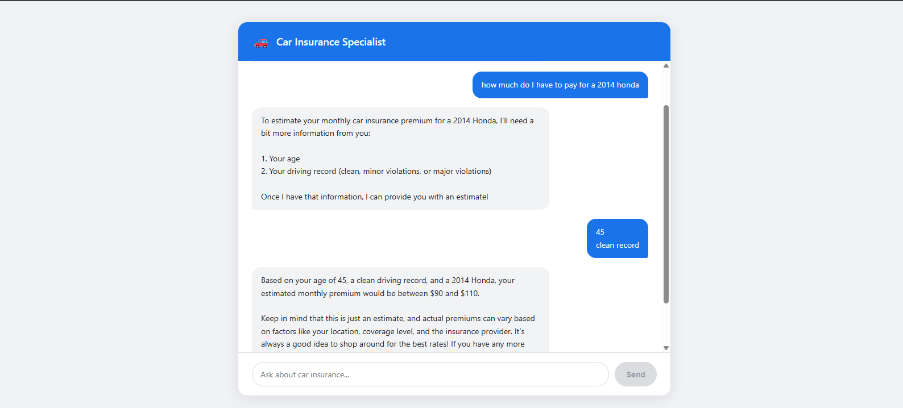

# 🚗 Car Insurance Specialist Agent

A LangChain-powered car insurance specialist agent built with Python, FastAPI, React, and GPT-4o-mini. Features streaming responses, multi-tool agent reasoning, and conversation memory.



---

## Tech Stack

| Layer | Technology |
|-------|-----------|
| Frontend | React 18 + Vite |
| Backend | Python 3.11 + FastAPI |
| Agent | LangChain |
| LLM | GPT-4o-mini |
| Streaming | Server Sent Events (SSE) |
| Infrastructure | Docker + Docker Compose |

---

## LangChain Components

- **ChatOpenAI** — LLM wrapper with streaming enabled
- **ChatPromptTemplate** — structured prompt with memory injection
- **ConversationBufferMemory** — remembers conversation history across turns
- **create_openai_functions_agent** — agent that uses OpenAI function calling to decide which tool to use
- **AgentExecutor** — runs the ReAct loop
- **@tool decorator** — defines the 4 insurance tools

---

## Agent Tools

The agent has 4 tools it decides when to use based on the user's question:

| Tool | When Used | What It Does |
|------|-----------|-------------|
| `calculate_premium_estimate` | User wants a premium estimate | Calculates monthly premium range based on age, vehicle year, and driving record |
| `check_coverage_requirements` | User asks about legal requirements | Returns minimum coverage requirements by Canadian province or US state |
| `explain_claim_process` | User had an accident or wants to file a claim | Returns step by step claims process by claim type |
| `compare_coverage_types` | User wants to understand coverage differences | Returns structured comparison of any two coverage types |

---

## How It Works

```
User asks a question
        │
        ▼
LangChain AgentExecutor starts ReAct loop
        │
        ▼
Agent reads tool descriptions
and decides if a tool is needed
        │
        ├── Tool needed → calls tool → gets result → forms answer
        │
        └── No tool needed → answers directly from LLM knowledge
        │
        ▼
Response streams token by token via SSE
        │
        ▼
Frontend displays words as they arrive
Tool usage badge shown if a tool was called
```

---

## Getting Started

### Prerequisites
- Docker Desktop installed and running
- OpenAI API key with GPT-4o-mini access

### Setup

1. Clone the repository
```bash
git clone https://github.com/pranav-mishra-96/car-insurance-agent.git
cd car-insurance-agent
```

2. Create your `.env` file
```bash
OPENAI_API_KEY=your_openai_api_key_here
OPENAI_MODEL=gpt-4o-mini
```

3. Start the application
```bash
docker-compose up --build
```

4. Open your browser
```
http://localhost:3000
```

---

## Project Structure

```
car-insurance-agent/
├── docker-compose.yml
├── .env
├── assets/
│   └── screenshot.png
├── backend/
│   ├── Dockerfile
│   ├── requirements.txt
│   ├── main.py        ← FastAPI app + SSE streaming
│   ├── agent.py       ← LangChain agent setup
│   ├── tools.py       ← 4 insurance tools
│   └── prompts.py     ← system prompt
└── frontend/
    ├── Dockerfile
    ├── package.json
    ├── vite.config.js
    ├── index.html
    └── src/
        ├── main.jsx
        ├── App.jsx    ← chat UI + SSE client
        └── App.css
```

---

## Example Conversations

**Premium Estimate:**
> "How much would insurance cost for a 2020 Honda Civic, I am 28 with a clean record?"

**Coverage Requirements:**
> "What coverage is mandatory in Ontario?"

**Claims Process:**
> "I just had an accident, what do I do?"

**Coverage Comparison:**
> "What is the difference between comprehensive and collision coverage?"

---

## Architecture Decisions

**Why LangChain?**
LangChain provides the agent orchestration layer — the ReAct loop, tool selection via OpenAI function calling, and conversation memory. Without it we would need to build all of this manually.

**Why SSE over WebSockets?**
SSE is a one-way push from server to client which is exactly what streaming LLM responses require. It is simpler than WebSockets and works through most firewalls and proxies without special configuration.

**Why tools instead of just prompting?**
Tools give the agent access to structured, deterministic data — premium calculations, legal requirements, claims steps. This is more reliable than asking the LLM to recall these from training data, and makes the agent's reasoning transparent through the tool badge in the UI.

**Why GPT-4o-mini?**
Fast, cost effective, and strong enough for conversational domain expertise. The function calling capability is reliable which is critical for tool selection.